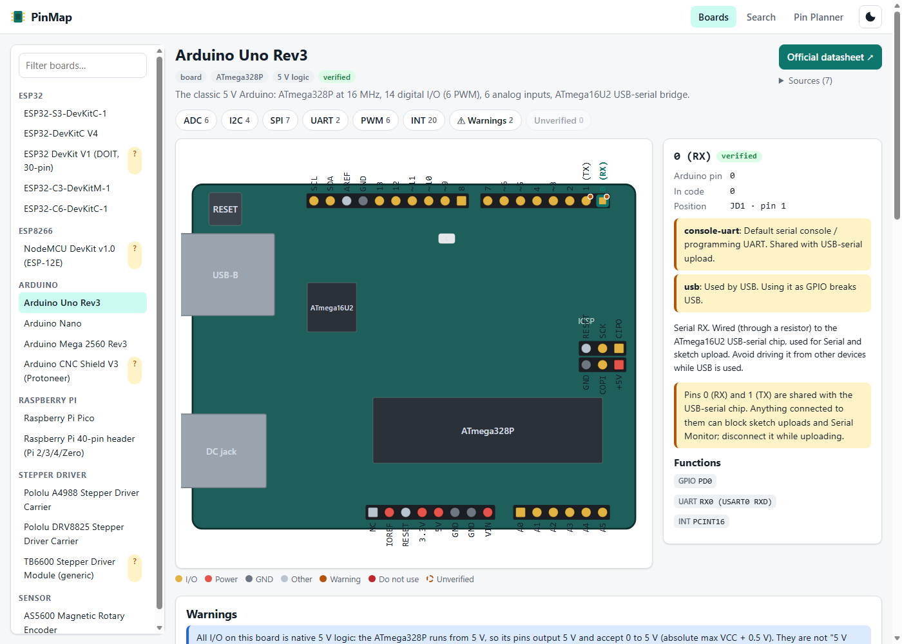

# PinMap

A searchable, interactive pinout reference for microcontroller boards and modules: ESP32, ESP8266, Arduino, Raspberry Pi, stepper drivers and sensors. Every pin table is built from the board's official datasheet or pinout document, cited in its data file. Anything that couldn't be confirmed is marked **unverified** in the UI.

**Live site:** https://julfikerhaider2001.github.io/pinmap/


<!-- Screenshot placeholder: replace assets/screenshot.png with a current capture. -->

## Features

- **Interactive board drawings (SVG).** Click or tap a pin to see every function (GPIO, ADC, PWM, I2C, SPI, UART, touch, RTC, USB, …) along with its warnings and source.
- **Filter buttons** highlight the pins that can do ADC, I2C, SPI, UART, PWM, touch, DAC and so on. On ESP32-class chips, the drawing separates "listed in the datasheet" from "possible through the GPIO matrix".
- **Clear warnings:** strapping pins, input-only pins, flash/PSRAM pins, boot behaviour, ADC2 with Wi-Fi, and 5 V tolerance.
- **Search** in plain words, e.g. `which pins can do I2C on ESP32-S3?`, `input only esp32`, `gpio34`, `SPI mega`.
- **Pin Planner:**
  - Assign pins to your project's parts (steppers, AS5600 encoders, limit switches, probe, servos, I2C/SPI/UART devices…).
  - It flags conflicts, bad pins, voltage mismatches and I2C address clashes. For example, four AS5600s share the fixed address 0x36.
  - It exports a C header full of `#define`s.
  - Projects are saved in your browser and can be exported or imported as JSON.
- **Datasheet links:** each board links to the official document it was built from.
- **Works everywhere:** phone and desktop, light and dark themes. It's a static site with no build step.

## Boards included

| Family | Boards |
|---|---|
| ESP32 | ESP32-S3-DevKitC-1, ESP32-DevKitC V4, ESP32 DevKit V1 (clone, unverified header order), ESP32-C3-DevKitM-1, ESP32-C6-DevKitC-1 |
| ESP8266 | NodeMCU v1.0 (ESP-12E) |
| Arduino | Uno Rev3, Nano, Mega 2560 Rev3, CNC Shield V3 (GRBL mapping) |
| Raspberry Pi | Pico (RP2040), 40-pin GPIO header (Pi 2/3/4/Zero) |
| Modules | A4988, DRV8825, TB6600 (generic, unverified), AS5600 |

## Run locally

The app loads JSON with `fetch`, so it must be served over HTTP. Opening `index.html` directly from disk won't work.

```sh
node tests/serve.mjs          # then open http://localhost:8080/
# or
python -m http.server 8080
```

## Tests

```sh
node tests/validate-data.mjs        # schema check of every board file
node --test tests/logic.test.mjs    # search, filters, planner rules, header export
node tests/browser-check.mjs        # loads every page in headless Edge/Chrome, fails on console errors, saves screenshots
```

## Adding a board

1. Read [data/SCHEMA.md](data/SCHEMA.md).
2. Create `data/boards/<id>.json`, citing the official sources in `sources`. Set `verified: false` on anything you couldn't confirm.
3. Add the id to `data/boards/index.json`.
4. Run `node tests/validate-data.mjs`.

## Project structure

```
index.html            app shell
css/main.css          styles, light/dark theme tokens
js/app.js             router and views (Boards, Search, Pin Planner)
js/core.js            pure logic: capabilities, search, planner checks, header export
js/render.js          JSON layout → SVG
js/schema.js          data validation (shared by app and tests)
js/data.js            data loading
js/storage.js         localStorage + import/export helpers
data/boards/*.json    one file per board/module, with sources
data/parts/parts.json Pin Planner part templates
tests/                Node tests, local server, headless browser check
```

## Disclaimer

PinMap is a convenience reference. Boards, clones and revisions differ, so always check against your own hardware and the linked datasheets before wiring anything.

## License

[MIT](LICENSE)
